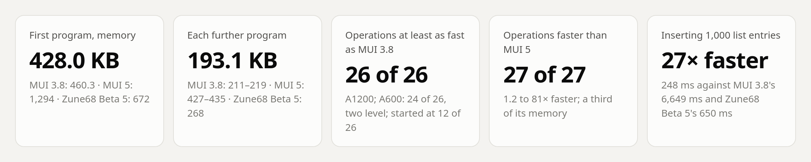

# OpenMUI

OpenMUI is a free, open-source replacement for MUI (the Magic User Interface)
on classic AmigaOS 3.x. It provides `muimaster.library`, the built-in classes
and a preferences program, and runs programs written for MUI 3, 4 and 5. It
needs AmigaOS 3.1 or newer, a 68000 or better and no FPU. Its look and memory
use follow MUI 3.8.

> **OpenMUI is not MUI and is not affiliated with MUI's authors.** MUI was
> created by Stefan Stuntz; MUI 4 and 5 come from the MUI team. OpenMUI is a
> separate library that is compatible with MUI's programming interface. MUI 3.8,
> 4 and 5 were studied black-box only: their behaviour was measured and their
> public documentation read; their code was never read, disassembled or copied.

**Version 1.0.** All figures in this document come from
cycle-exact emulation (FS-UAE) of an A1200 and an A600. They have not been
measured on a real Amiga.

## Statistics



### Speed

Milliseconds per operation, measured 2026-11-23: median of 9 repetitions, the same test
program on every library, cycle-exact FS-UAE emulation of an A1200 (68EC020,
14 MHz) and an A600 (68000, 7 MHz), OS 3.1 with 4 MB fast RAM, two instances
of each library. Zune68 is Beta 5 (2026.11.22) as released. Lower is better.
Ranges are the spread over the two instances.

| Operation | A1200 OpenMUI | A1200 MUI 3.8 | A1200 Zune68 | A600 OpenMUI | A600 MUI 3.8 | A600 Zune68 |
|---|---:|---:|---:|---:|---:|---:|
| Application, empty | 15.9-16.1 | 89-93 | 14.5-14.7 | 66 | 351 | 59-63 |
| Application with windows, create | 183-191 | 233-236 | 258-263 | 745 | 931 | 1,045-1,079 |
| Window open + close | 400 | 518 | 600 | 1,381 | 1,758 | 2,171-2,207 |
| Full redraw | 133 | 141-151 | 153 | 442 | 475 | 531 |
| Relayout | 173 | 198-207 | 300-304 | 608 | 702 | 1,157-1,175 |
| Slider set | 2.7 | 4.0-4.1 | 4.4 | 10.1 | 15.1 | 16.0 |
| Notification chain | 5.6 | 7.8-7.9 | 9.1 | 21 | 29 | 33 |
| Cycle set | 2.0 | 2.4 | 4.7-4.8 | 7.8 | 9.3 | 19.1-19.6 |
| Radio set | 8.3 | 15.6 | 21 | 32 | 60 | 82 |
| Text set | 2.4 | 2.5 | 2.4 | 9.4 | 9.7 | 9.4 |
| List insert, 100 rows | 61-62 | 830 | 104-106 | 226 | 2,744 | 417-427 |
| List insert, 1,000 rows | 248 | 6,648 | 642-659 | 1,009 | 23,924 | 2,689-2,794 |
| List sort, 1,000 rows | 94 | 658 | 111 | 381 | 2,489 | 434 |
| List scroll, one row | 13.2 | 14.6 | 18.0-18.3 | 37 | 40 | 56-58 |
| Button click | 16.6 | 22-23 | 17.9 | 69 | 91-92 | 74 |
| String, one key | 6.7 | 7.6-7.9 | 10.8 | 26 | 31 | 44 |
| String, backspace | 6.6 | 7.5-7.8 | 10.4 | 26 | 31 | 42 |
| Register page | 43 | 53 | 58-60 | 145 | 160 | 217-224 |
| Popup open + close | 96 | 120 | 140 | 339 | 400-408 | 484-489 |
| Uniconify | 336-340 | 446 | 996-1,018 | 1,228-1,248 | 1,532 | 3,939-4,122 |

Operations not listed (menu, iconify, window resize, list active, list scroll
by page, list insert of one row) are in
[docs/lean/measurements.md](docs/lean/measurements.md). OpenMUI is at 0.99 or
below of MUI 3.8's time in all 26 operations on the A1200; on the A600, 24 of 26
are faster, menu open + close is level (1.00) and list insert of one row is 1.01.
Zune68 Beta 5 takes less time than MUI 3.8 in 7 of the 26 on the A1200 (empty
application, list insert of 100 and 1,000 rows, list sort, button click, list
scroll by page, text set) and 9 on the A600 (also menu open + close and iconify); iconify on the
A1200 is level. Against OpenMUI, Zune68 is faster at starting an empty
application (0.91 on the A1200, 0.92 on the A600) and at menu open + close on
the A600 (0.86), and level at text set; OpenMUI is faster in the others.

Against MUI 5 (A1200, OS 3.2.1, OpenMUI and Zune68 opened as MUI 5 version
21.227, same conditions), OpenMUI is faster in all 27 operations measured (ratio
0.01 to 0.80), Zune68 in 23 of 27 (0.03 to 0.89); relayout is level (1.01), and
cycle set, radio set and list insert of one row take 1.48, 1.83 and 1.50 times
MUI 5's time on Zune68. Zune68 is faster than OpenMUI at starting an empty
application (0.87) and at shortening a text (0.95):

| Operation | OpenMUI | MUI 5 | Zune68 | OpenMUI / MUI 5 | Zune68 / MUI 5 |
|---|---:|---:|---:|---:|---:|
| Application, empty | 18.2-18.7 | 299 | 15.6-16.3 | 0.06 | 0.05 |
| Application with windows, create | 197-204 | 574-582 | 270-288 | 0.35 | 0.48 |
| Window open + close | 441-448 | 1,005-1,030 | 641-663 | 0.44 | 0.64 |
| Full redraw | 139 | 207 | 159 | 0.67 | 0.77 |
| Relayout | 181 | 317 | 313-326 | 0.57 | 1.01 |
| Slider set | 3.0 | 6.8 | 4.8 | 0.45 | 0.70 |
| Notification chain | 6.2 | 12.8 | 9.7 | 0.49 | 0.76 |
| Cycle set | 2.0 | 2.7 | 4.1 | 0.75 | 1.48 |
| Radio set | 8.4 | 11.9 | 22 | 0.70 | 1.83 |
| Text set | 1.7 | 2.3 | 1.7 | 0.73 | 0.74 |
| List insert, 100 rows | 62 | 2,037 | 106-112 | 0.03 | 0.05 |
| List insert, 1,000 rows | 248 | 20,244 | 674-734 | 0.01 | 0.03 |
| List sort, 1,000 rows | 137 | 2,306 | 153 | 0.06 | 0.07 |
| List scroll, one row | 14.6 | 21 | 16.8 | 0.69 | 0.80 |
| Button click | 16.7 | 21 | 18.2-18.6 | 0.80 | 0.88 |
| String, one key | 7.5 | 14.9 | 10.8 | 0.50 | 0.72 |
| String, backspace | 7.4 | 14.2 | 10.5 | 0.52 | 0.73 |
| Register page | 45 | 89 | 54 | 0.51 | 0.61 |
| Popup open + close | 104 | 528-540 | 140 | 0.19 | 0.26 |
| Uniconify | 371 | 1,214-1,230 | 1,064-1,104 | 0.30 | 0.89 |
| Text shorten set | 3.4 | 4.7 | 3.2-3.3 | 0.73 | 0.69 |
| List insert, one row | 9.0 | 23 | 34 | 0.40 | 1.50 |
| Menu open + close | 20.0 | 26-27 | 20.0 | 0.75 | 0.75 |


## What it contains

- **`muimaster.library`**, built with GCC for the 68000, no FPU. The library
  file keeps MUI's name and version numbers because programs depend on them.
- **Per-program MUI identity.** Each program gets the MUI version it asks for:
  a MUI 3 program sees MUI 3.8 (19.35), a MUI 4 program MUI 4, a MUI 5
  program MUI 5 (21.227). The preferences have "Behave as" (Automatic, MUI 3.8,
  MUI 4, MUI 5) and a list of programs with a MUI of their own.
- **On-demand class files.** About 45 rarely used classes and library parts are
  separate files in `LIBS:OpenMUI`, loaded the first time a program needs one.
  A MUI 3 program pays nothing for MUI 4/5 features.
- **OpenMUI preferences** (`SYS:Prefs/OpenMUI`) with an import of MUI 3.8's
  settings.
- **Bundled MUI classes** with their preference pages: NList, NListtree,
  TextEditor, BetterString, TheBar, Busy, Listtree and others, and Spot's
  [UP-MCC](https://github.com/spotUP/selecta) 1.0 (eleven flat-look classes,
  `up-mcc.library`, the Inter font, Dark and Light themes; MIT).
- **Installer** that leaves a real MUI alone, keeps every file it replaces and
  provides *Use real MUI*, *Use OpenMUI* and *Uninstall* in `SYS:OpenMUI`.
- Swedish catalogs, an SDK with examples, the programmer reference and the
  full source.

## Installing

Unpack the archive `OpenMUI.lha` and double-click *Install* (Amiga Installer
43 or newer; on OS 3.1 use Installer 43.3 from Aminet). Details, switching to
a real MUI and uninstalling: [User guide](docs/user-guide.md). The drawers
OpenMUI uses are `LIBS:OpenMUI` (class files), `ENVARC:OpenMUI` and
`ENV:OpenMUI` (settings) and `SYS:Prefs/OpenMUI`.

## Compatibility

Tested in emulators against real MUI 3.8 and MUI 5 with 182 programs and class
demos (100 MUI 3 programs, 24 MUI 4/5 programs, 58 add-on class demos),
including YAM, AmIRC, AmFTP, IBrowse, NList, TextEditor and TheBar. 19 of
MUI's 27 demo windows are pixel-identical to MUI 3.8. Results:
[tests/lean/real-programs.md](tests/lean/real-programs.md). Known differences:
[developer guide](docs/developer-guide.md#known-differences-from-mui) and
[docs/reference/differences.md](docs/reference/differences.md).


## Building

Needs m68k-amigaos-gcc (GCC 16 used), GNU make, sfdc, fd2sfd, FlexCat and lha.

```sh
git submodule update --init --recursive
make -j4 all
make check     # needs the Python bundled with the Amiga toolchain
make release   # the archive and its Aminet readme, in build/muimaster/release
```

`make check` runs the linked 68000 code with modelled OS calls. It does not
establish GUI compatibility or speed on Amiga hardware.

## Documentation

| Document | Content |
|---|---|
| [User guide](docs/user-guide.md) | Installing, switching to a real MUI, uninstalling, preferences, "Behave as", troubleshooting |
| [Developer guide](docs/developer-guide.md) | Supported interface, identity mechanism, known differences, building, tests, clean-room rule, contributing |
| [Programmer reference](docs/reference/README.md) | Library functions, every class with attributes and methods, custom and external classes, differences from MUI 3.8 and MUI 5 |
| [Changelog](CHANGELOG.md) | Release history |
| [Production gates](docs/production.md) | The checkable criteria for version 1.0 |
| [docs/lean/](docs/lean/README.md) | The development log: rounds, measurements, class split, roadmap |
| [dist/Compatibility](dist/Compatibility) | Compatibility workloads and their limits |
| [tests/native/PERFORMANCE.md](tests/native/PERFORMANCE.md) | Speed measurement method |

The release archive contains the guides, the reference and the changelog as
plain text in `Docs/OpenMUI`.

## Origins

| | |
|---|---|
| **Zune** | The MUI-compatible GUI toolkit of [AROS](https://github.com/aros-development-team/AROS), by The AROS Development Team. |
| **Zune68** | Zune ported to classic AmigaOS 3 by Stefan Reinauer ([reinauer/zune68](https://github.com/reinauer/zune68)). |
| **OpenMUI** | The lean edition of Zune68: rewritten classes for 68000-class machines, with MUI 3.8's look, memory use and speed as the target and MUI 3, 4 and 5 programs as the workload. |

The AROS Public License applies to the core (`LICENSE`). The bundled classes
keep their own licences and notices (`LEGAL`, `ACKNOWLEDGEMENTS`). UP-MCC is
by spotUP (MIT; Lucide icons ISC; Inter font SIL OFL 1.1).

## Repository branches

- `aros-upstream` holds the filtered AROS history (component source, layout,
  authorship and dates retained; commit messages carry an `AROS-Commit`
  trailer). `main` is Zune68's work on top of it. `lean` is the OpenMUI line.
- The importer, the path list and the procedure for merging later AROS
  updates are in `tools/upstream/` (`import-aros.py`, `paths.txt`,
  `source.json`, `commit-map`). Use a complete AROS clone and a new output
  directory; never fetch the unfiltered AROS branch into `aros-upstream`.
- TheBar is a git submodule: run `git submodule update --init --recursive`
  after cloning.

GitHub Actions builds and checks every push. A date tag such as `v2026.11.11`
creates a draft pre-release with the archive and the Aminet readme.
